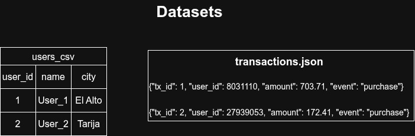

# Processing Out-Of-Memory Datasets: Pandas vs DuckDB vs Spark

In modern data engineering, data engineers frequently encounter datasets that exceed available machine memory. This project benchmarks and demonstrates how different technologies—**Pandas**, **DuckDB**, and **Apache Spark**—handle out-of-core data processing when constrained by severe hardware limitations.

---

## Architecture & Scenario Overview

To simulate a realistic cloud data lake architecture, the environment is configured with resource-constrained Virtual Machines (VMs) accessing an S3-compatible object storage service ([RustFS](https://github.com/rustfs/rustfs) / MinIO):

- **Compute Constraints**: 2 vCPUs and 3 GB of RAM (deliberately constrained to test out-of-core handling).
- **Storage Layer**: S3-compatible object storage hosting raw datasets in a bucket (`s3://spark-data/`).
- **Target Pipeline**: Calculate total transaction sales amount grouped by user city, ordered descending.

---

## Datasets

The analytical workload joins two large datasets:

| Dataset | Format | Size | Records | Description |
|---|---|---|---|---|
| `users.csv` | CSV | ~1.1 GB | 30,000,000 | User metadata: `user_id`, `name`, `city`, `signup_channel` |
| `transaction_logs.json` | JSONL (Newline-delimited JSON) | ~4.5 GB | 60,000,000 | Historical transactions: `tx_id`, `user_id`, `amount`, `event` |




---

## Evaluated Approaches

### 1. Pandas: In-Memory Full Load ([`pandas_load_memory.py`](pandas_load_memory.py))
- **Strategy**: Reads both `users.csv` and `transaction_logs.json` into RAM simultaneously using `pd.read_csv()` and `pd.read_json(..., lines=True)`.
- **Under the Hood**:
  1. Downloads and parses the entire CSV and JSONL files into memory.
  2. JSON parsing in Python creates heavyweight Python dictionary and string objects, ballooning the memory footprint to 3–5x the raw file size.
  3. Allocates memory for both DataFrames simultaneously.
  4. Attempts a hash join `pd.merge()` which requires building another full intermediate DataFrame.
- **Outcome**: **Out of Memory (OOM Killer)**. The VM runs out of physical RAM (3 GB) and rapidly exhausts SWAP, causing the Linux kernel to terminate the process (`SIGKILL`).

### 2. Pandas: Sequential Chunking ([`pandas_wchunk.py`](pandas_wchunk.py))
- **Strategy**: Keeps only required columns of `users.csv` in RAM (`user_id`, `city`) and streams `transaction_logs.json` in sequential batches using `chunksize=1_000_000`.
- **Under the Hood**:
  1. For each 1M row chunk, performs an inner join against `users_df`.
  2. Partially aggregates `SUM(amount)` per city and accumulates the results in a rolling series.
- **Outcome**: **Completed in 39,091.00s (~10.86 hours)**. While chunking prevents an OOM crash, unindexed repeated joins on 30 million rows across 60 chunks and string-based key lookups introduce severe computational overhead.

### 3. DuckDB: Out-of-Core Analytical SQL ([`duckdb_total_by_city.py`](duckdb_total_by_city.py))
- **Strategy**: Uses DuckDB's native columnar execution engine and `httpfs` extension to query files directly from S3-compatible storage.
- **Under the Hood**:
  1. Direct zero-copy scanning of remote files via `read_csv_auto()` and `read_json_auto()`.
  2. Vectorized query execution engine with automatic projection and filter pushdown.
  3. Purpose-built out-of-core memory manager that streams data blocks through memory buffers and spills intermediate hash tables to disk when RAM thresholds are reached.
- **Outcome**: **Completed in 87.28s** (~448x faster than Pandas chunking). DuckDB handles out-of-core processing efficiently on a single node without manual chunking.

### 4. Apache Spark: Single-Node Deployment ([`spark_total_by_city.py`](spark_total_by_city.py))
- **Strategy**: Runs PySpark locally on a single VM with driver memory capped at 2 GB (`spark.driver.memory = 2g`).
- **Under the Hood**:
  1. Uses Hadoop S3A filesystem connector (`org.apache.hadoop.fs.s3a.S3AFileSystem`).
  2. Lazy evaluation constructs an optimized Directed Acyclic Graph (DAG) with Catalyst optimizer and Tungsten execution.
  3. When memory limits are reached during join and aggregation shuffles, Spark automatically spills partitions to disk (`spark.local.dir`).
- **Outcome**: **Completed in 282.94s**. Fully reliable out-of-core processing, but slower than DuckDB due to JVM initialization, serialization overhead, and generic cluster scheduling primitives on a single machine.

### 5. Apache Spark: Distributed Cluster Deployment ([`spark_total_by_city_workers.py`](spark_total_by_city_workers.py))
- **Strategy**: Scales PySpark out to a cluster consisting of 1 Master node and 3 Worker nodes (4 VMs total).
- **Under the Hood**:
  1. Master tracks workers, coordinates cluster resources, and assigns execution stages.
  2. Data partitions are split across 3 worker nodes, running parallel tasks and executing distributed shuffle operations for the join and aggregation.
- **Outcome**: **Completed in 185.80s**. Reduces execution time by ~34% compared to single-node Spark by distributing CPU and disk I/O across worker instances.

---

## Benchmark Results

All benchmarks were conducted using identical datasets (1.1 GB CSV + 4.5 GB JSONL) on 2 vCPU, 3 GB RAM virtual machines connected to a local S3-compatible object store:

| Engine | Deployment | Memory Limit | Execution Time | Status | Speedup vs Pandas Chunk |
|---|---|---|---|---|---|
| **Pandas (Full Load)** | Single Node (1 VM) | 3 GB RAM | **OOM** | Crashed (`SIGKILL`) | N/A |
| **Pandas (Chunked)** | Single Node (1 VM) | 3 GB RAM | **39,091.00s** (~10.8h) | Success | 1.0x (Baseline) |
| **DuckDB** | Single Node (1 VM) | 3 GB RAM | **87.28s** | Success | **~448x faster** |
| **Apache Spark** | Single Node (1 VM) | 2 GB Driver | **282.94s** | Success | **~138x faster** |
| **Apache Spark** | 4-Node Cluster (1M + 3W) | 2 GB Driver / Node | **185.80s** | Success | **~210x faster** |

---

## Repository Structure

```text
├── README.md                           # Main project documentation & benchmark analysis
├── requirements.txt                    # Python dependencies (Pandas, DuckDB, Boto3, etc.)
├── .env.example                        # Template for S3 & cluster environment variables
├── assets/
│   ├── architecture-Datasets.jpg       # Dataset schema illustration
│   ├── architecture.drawio             # Diagram source files (Draw.io)
│   └── deal-with-big-ds.md             # Benchmark notes & original analysis log
├── src/
│   ├── pandas_load_memory.py           # Approach 1: Naive full-load Pandas implementation
│   ├── pandas_wchunk.py                # Approach 2: Chunk-based Pandas pipeline
│   ├── duckdb_total_by_city.py         # Approach 3: Out-of-core DuckDB implementation
│   ├── spark_total_by_city.py          # Approach 4: Single-node PySpark implementation
│   └── spark_total_by_city_workers.py  # Approach 5: Distributed PySpark cluster implementation
└── utils/
    └── generate_data.py                # Synthetic dataset generation utility
```

---

## Setup & Execution Guide

### 1. Prerequisites

- **Python**: 3.10+
- **Java**: OpenJDK 8, 11, or 17 (required for Apache Spark / PySpark)
- **Object Storage**: S3-compatible service (e.g. MinIO, RustFS, or AWS S3)
- **Hadoop AWS JARs** (for Spark): If connecting Spark to S3, ensure `hadoop-aws` and `aws-java-sdk-bundle` JARs are available in `$SPARK_HOME/jars/`.

### 2. Environment Configuration

Clone the repository and create a Python virtual environment:

```bash
git clone https://github.com/juanccq/processing-oom-datasets.git
cd processing-oom-datasets
python3 -m venv .venv
source .venv/bin/activate
pip install -r requirements.txt
```

Create a `.env` file from [.env.example](.env.example):

```bash
cp .env.example .env
```

Configure your credentials and endpoints in `.env`:
